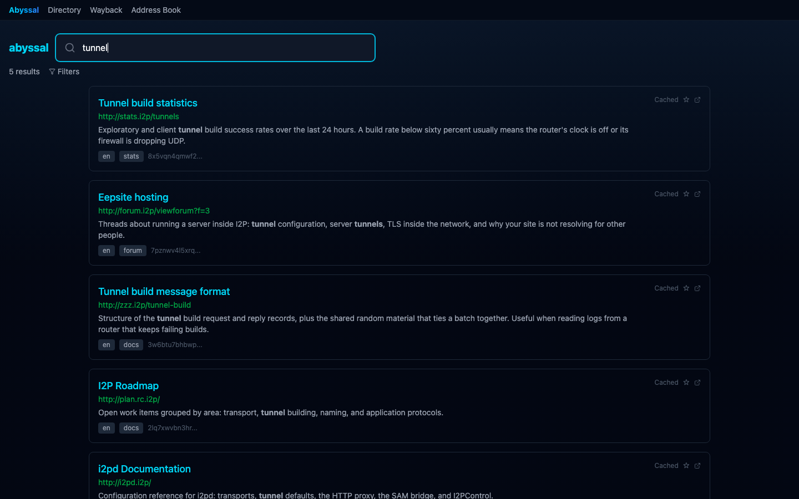
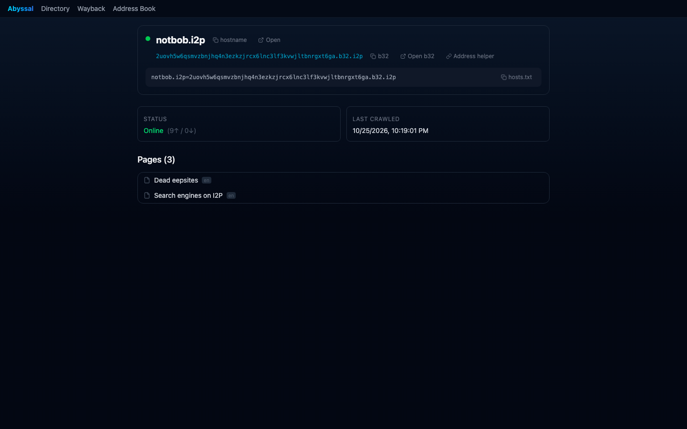
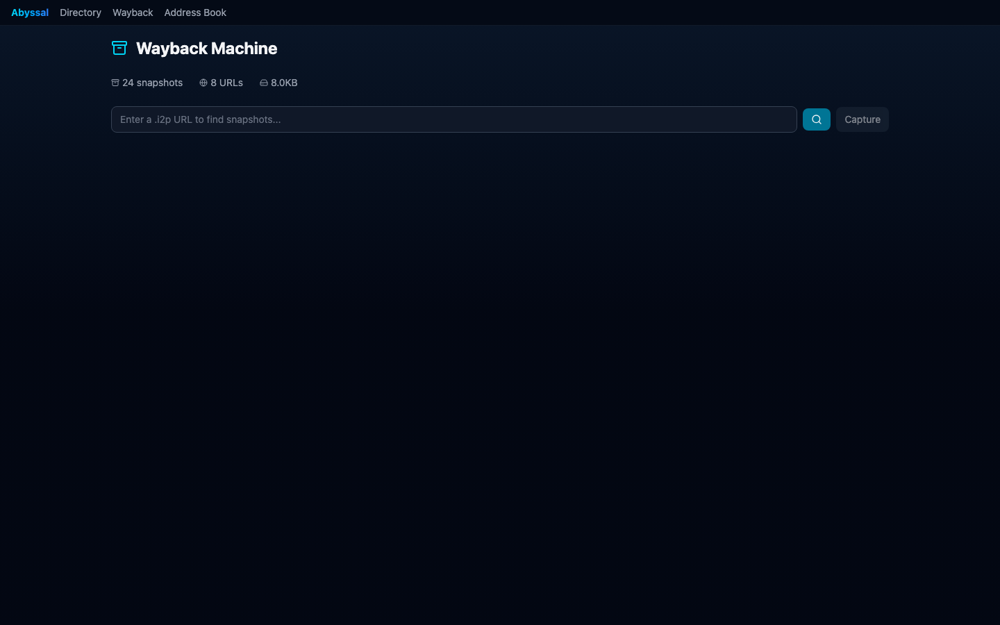
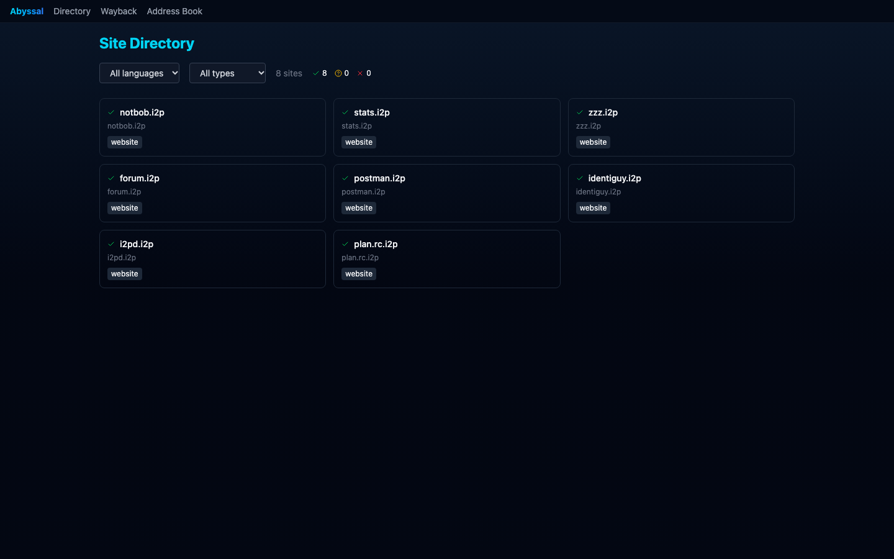
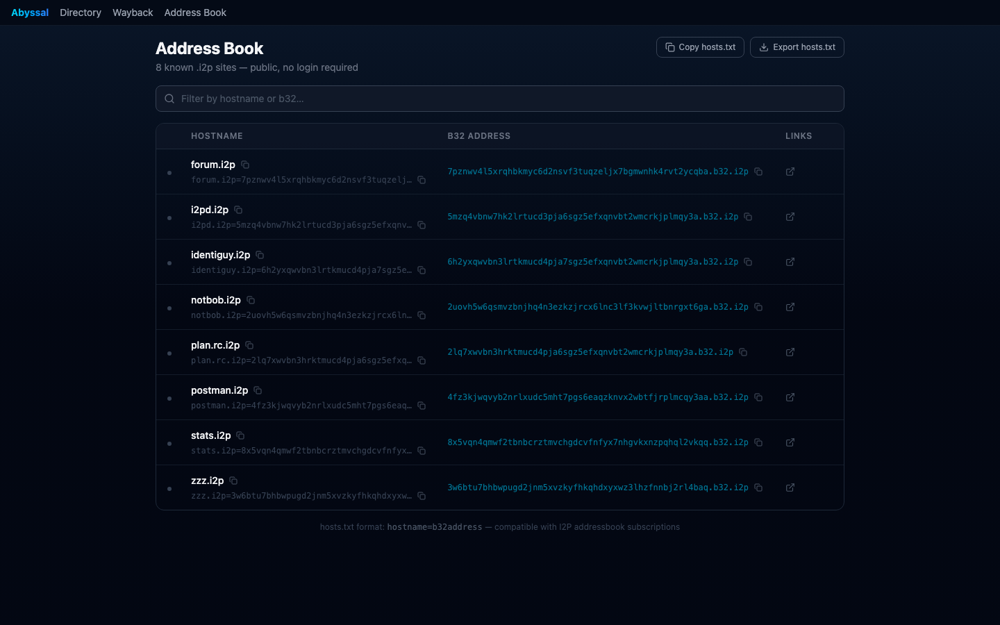

# Nexus

A search engine for I2P, plus a dashboard for the router that runs it. One repo, two apps, one i2pd instance behind them.

[35 second walkthrough of the running app](https://files.catbox.moe/urwmig.mp4)



## The problem

I2P sites are addressed by 52 character base32 strings. There is no DNS. The handful of search engines that exist crawl on their own schedule and hand back a title and a link, and when a site goes offline its content goes with it. Nexus covers both halves of that: finding sites, and seeing what your own router is doing while you visit them.

## Abyssal

The public half. A crawler fetches eepsites through your router's HTTP proxy, stores what it finds, and builds a full text index on top of it.

The index is SQLite FTS5 with porter stemming, so a search for `tunnels` also matches pages that say `tunnel`. Results can be narrowed by language and by site type (directory, docs, forum, stats, service), and a search is a plain URL, so `/?q=tunnel&type=docs` is shareable.

There is a browse view for when you do not have a query, and a link graph built from links the crawler actually found, which is how you run into sites that no directory lists.

Every capture is also written to disk with its metadata, so there is an archive of old versions. If a site disappears you can still open what it looked like the last time it was crawled.

Crawling I2P politely matters, so the crawler has controls: up to 20 workers sharing one proxy connection, a delay between requests per worker, a page limit, a depth limit, and pause, resume or rerun on a running job. A scheduler re-crawls known sites on an interval so the index does not rot.

| Site detail | Wayback archive |
|---|---|
|  |  |

| Directory | Address book |
|---|---|
|  |  |

## Prism

The private half, a dashboard for the i2pd router you are running. Router health, bandwidth, transport and peer counts, tunnel build success rate, uptime, and a tunnel list with the state of each one.

It also has a browser tab that proxies `.i2p` pages through your own router and rewrites links so clicking around stays inside the proxy, and an address book manager for `hosts.txt` subscriptions. Those routes sit behind an `api-key` header, because they control your router.

## Running it

### Docker

```bash
docker compose -f abyssal/docker-compose.yml up --build
```

- `http://localhost` for Abyssal
- `http://localhost/dashboard/` for Prism

This needs a Linux host. i2pd uses `network_mode: host` so it can publish its LeaseSet, which does not work on Docker Desktop for macOS or Windows.

### Natively on macOS

The native path is how the project gets developed, since the Docker stack cannot run on a Mac.

```bash
brew install i2pd
```

Start the router with Homebrew's datadir. A fresh empty datadir has no reseed certificates and will fail to bootstrap.

```bash
i2pd --datadir=/opt/homebrew/var/lib/i2pd
```

Install the backend:

```bash
cd abyssal
python3 -m venv .venv
.venv/bin/pip install -e .
```

Run it with paths pointing at wherever you want the database and archive to live:

```bash
cd abyssal/backend
DB_PATH=../../.local/data/crawler.db \
ARCHIVE_ROOT=../../.local/archive \
I2PD_HTTP_PROXY=http://127.0.0.1:4444 \
PYTHONPATH=.. \
../.venv/bin/uvicorn main:app --port 8000
```

Then the frontend, which proxies `/api` to the backend you just started:

```bash
cd abyssal/frontend/client
pnpm install
VITE_API_PROXY=http://127.0.0.1:8000 pnpm dev --port 5173
```

API docs are at `http://127.0.0.1:8000/docs`.

## Configuration

Everything is read from the environment at startup.

| Variable | Default | What it does |
|---|---|---|
| `API_KEY` | `dev-key-12345` | value the `api-key` header must send to reach admin routes |
| `PROXY_TOKEN` | derived from `API_KEY` | proxy-only token put in public page and snapshot views; fetches `.i2p` hosts only |
| `BROWSER_TOKEN` | derived from `API_KEY` | proxy-only token the Prism dashboard uses for its browser tab |
| `I2PD_HTTP_PROXY` | `http://i2pd:4444` | proxy the crawler and the resolver fetch through |
| `DB_PATH` | `/data/crawler.db` | SQLite file for the index, jobs, and archive metadata |
| `ARCHIVE_ROOT` | `/data/archive` | where snapshot files are written |
| `AUTOSEED_ENABLED` | `true` | crawl `abyssal/seeds.py` on a fresh database, and resume jobs left running |
| `SCHEDULER_ENABLED` | `true` | start the periodic recrawl scheduler |
| `REGISTRY_CRAWLER_ENABLED` | `true` | start the address book crawler and the host resolver |
| `VITE_API_PROXY` | `http://nginx` | frontend dev server proxy target |

The three crawler flags default to on for a real deployment. Set them to `false` when you want the API to serve existing data and nothing else, which is what you want if you are demoing or showing the index to someone.

## Sample data

A fresh database is empty and a working index needs an hour of crawling at minimum, so there is a script that fills in a small labelled corpus:

```bash
cd abyssal
PYTHONPATH=. DB_PATH=../.local/data/crawler.db ARCHIVE_ROOT=../.local/archive \
  .venv/bin/python scripts/seed_demo.py
```

It writes 8 sites and their pages plus 24 archive snapshots. The hostnames are real I2P sites but the page text is written by the script, and each stored snapshot says so at the bottom.

## Layout

```
abyssal/
  abyssal/          crawler, index, wayback, resolver, API
  backend/          FastAPI entry point
  frontend/client/  React search UI
  scripts/          seed_demo.py
  nginx/            public reverse proxy
prism/
  backend/services/ router, browser and addressbook services
  frontend/client/  React dashboard
tests/              pytest suites for both halves
```

## Status

23 commits, all from June 2026. The Docker stack is the deployment target and runs on Linux. The native macOS path works for Abyssal, which is what the screenshots above come from.

Still open: a read only public mirror of the index, per site crawl delays so the crawler is gentler on small hosts, and some way to handle old captures being reused for abuse.
